# Atenas SGE — Software de Gestão Empresarial

> Valores marcados com *(hipótese)* são dados mockados ou estimativas a validar com uma empresa real.

**Atenas SGE é o software de gestão empresarial em que pequenas indústrias cadastram projetos e as demandas dos processos de Almoxarifado, Operação (fabricação) e Montagem num só lugar, e preveem a equipe necessária com base no próprio histórico.**

---

## 1. A dor

**Quem sofre:** o gestor de produção (gerente, encarregado, chefe de setor) de uma empresa industrial pequena, e o funcionário que recebe as demandas.

**Quando:** todo dia, na distribuição das tarefas entre os processos (planejamento, almoxarifado, fabricação e montagem), e todo mês, quando é preciso decidir quantas pessoas alocar para a meta de itens a concluir.

**Quanto custa hoje** *(hipótese)*:

- **Sobrecarga (a dor central):** a demanda chega sem filtro e cai sempre nos mesmos funcionários, porque o gestor não enxerga a carga de cada um. O resultado é cansaço, erro, retrabalho e risco de afastamento ou saída da pessoa.
- **Tempo:** o gestor gasta horas por semana consolidando planilhas e conferindo com o chão de fábrica o que está pendente.
- **Dinheiro:** sem saber quantos funcionários a meta do mês exige, a empresa alterna hora extra num mês e ociosidade em outro.
- **Risco:** informação faltando compromete a decisão (o gestor não vê o todo) e informação demais atrapalha a operação (o funcionário se perde no que não é dele).

**Como se resolve hoje:** planilhas em Excel, quadro de papel, mensagens de WhatsApp e memória do encarregado. Cada processo tem seu controle e nenhum se conversa. O histórico existe, mas parado numa planilha, sem virar decisão.

## 2. Persona

**Carlos Mendes, 42 anos, encarregado de produção** de uma metalúrgica com cerca de 25 funcionários *(fictício)*.

Ele começa o dia anotando num caderno as demandas de cada processo e depois passa tudo para uma planilha que só ele entende. No fim do mês, decide de cabeça quantas pessoas colocar para a meta seguinte, e às vezes erra para mais ou para menos, embora tenha guardado, em Excel, o histórico de funcionários, itens concluídos e horas de vários meses. O funcionário pergunta a ele o que fazer porque não tem onde consultar. As demandas chegam sem filtro e acabam sempre nos mesmos operadores, porque ele não enxerga a carga de cada um. O que atrapalha: nenhum sistema mostra o projeto e quem está com cada demanda no mesmo lugar, e os sistemas de gestão (ERP/MES) que conhece são caros e pesados para o tamanho da empresa.

**Persona secundária, o montador:** Marcos, 28 anos, montador. Só precisa saber qual é a demanda dele hoje, de qual projeto, e registrar quando ela foi finalizada na montagem.

## 3. Concorrentes e alternativas

| Alternativa | O que faz mal para essa persona |
|---|---|
| Planilha (Excel / Google Sheets) | Cada setor tem a sua, sem controle de quem vê o quê, sem alerta e sem previsão. O histórico fica parado, e um erro de digitação passa despercebido. |
| Quadro de papel e WhatsApp | Não deixa histórico, as informações se perdem e o funcionário vê (ou perde) mensagens que não são dele. |
| Trello / Asana | Genéricos: não têm o conceito de projeto com demandas de itens (RG, material, quantidade) nem de processo produtivo, e não indicam quantos funcionários alocar. |
| ERP / MES (ex.: TOTVS, SAP) | Caros, com implantação longa, muita informação em cada tela e exigem equipe de TI. Excessivos para uma operação pequena. |

## 4. Proposta de valor

**Para a pequena indústria, o Atenas SGE reúne projetos e demandas num só lugar, com acesso por categoria e por processo, e no plano Expert transforma o histórico do próprio cliente (um CSV do Excel) numa previsão de quantos funcionários a meta do mês exige e em indicadores da produção, evitando a sobrecarga da equipe, sem o custo e a complexidade de um ERP.**

## 5. Modelo de receita com Stripe

O plano **é** o papel do usuário: pagar o Expert muda o papel, e o middleware de acesso passa a liberar os recursos. O papel só muda quando o **webhook** do Stripe confirma o pagamento.

**O CRUD de projetos e demandas é gratuito**: cadastrar, editar e excluir não dependem de plano, só da categoria da pessoa (seção 8). O que se paga é a análise.

| | **Professional** | **Expert** |
|---|---|---|
| Preço | Grátis | R$ 149/mês por conta |
| Cadastrar, editar e excluir projetos e demandas (conforme a categoria) | Sim | Sim |
| Ver a fila da própria etapa e avançar demandas | Sim | Sim |
| Projetos ativos ao mesmo tempo *(hipótese)* | Até 3 | Sem limite |
| Demandas abertas ao mesmo tempo *(hipótese)* | Até 50 | Sem limite |
| **Análise:** previsão de equipe (regressão linear múltipla treinada com o histórico em CSV) | Não | Sim |
| **Análise:** indicadores (demandas por processo e concluídas × pendentes, com impressão) | Não | Sim |

**Por que alguém pagaria o Expert:** o Professional resolve o registro e o fluxo, mas o limite de 3 projetos ativos aperta quando a operação cresce, e só o Expert ajuda a decidir (previsão de equipe) e a acompanhar (indicadores). A previsão evita hora extra e sobrecarga, e o custo mensal tem que ser menor que uma hora extra evitada *(hipótese a validar)*.

**Funil:** o Professional já organiza o dia a dia e gera o histórico: cada demanda finalizada pela Montagem grava a data de finalização, e a soma das quantidades por mês é a "demanda" usada na previsão. Quando o cliente quer decidir a equipe, o Expert aproveita o histórico que ele já tem. Os limites do Professional contam só projetos e demandas **ativos**: o que é concluído ou excluído sai da contagem.

### Ciclo de vida da assinatura

A assinatura é um **estado**, não um pagamento: o Stripe cobra todo mês e quem sabe o estado verdadeiro é ele. O banco guarda uma cópia (tabela `assinaturas`), mantida em dia pelos **webhooks**. O plano do usuário nunca muda porque o navegador voltou do checkout: ele muda quando o webhook chega, é validado e é processado. O app só abre caminhos (checkout e portal do cliente).

| Evento do Stripe | O que o app faz |
|---|---|
| `checkout.session.completed` | Guarda o customer e a subscription e muda o plano para Expert |
| `customer.subscription.updated` | Atualiza o status (active, past_due, cancelamento agendado...) e recalcula o plano |
| `customer.subscription.deleted` | A assinatura terminou: a conta volta ao Professional (Free) |
| `invoice.payment_failed` | Marca a assinatura como inadimplente e suspende o plano pago; quando o pagamento é regularizado, o acesso volta sozinho |

Todo webhook tem a assinatura validada, e o mesmo evento reenviado pelo Stripe não é processado duas vezes (tabela `eventos_stripe`). O botão **Gerenciar assinatura** (página Planos) abre o portal do cliente do Stripe, onde a pessoa troca de plano e cancela sozinha. O **painel admin** mostra usuários por plano, assinaturas ativas, o MRR de teste e os últimos eventos.

### Como a previsão de equipe funciona

É uma **regressão linear múltipla**, treinada com o histórico do próprio cliente, no estilo de ferramentas como o Orange:

1. **Dados:** o usuário envia um CSV exportado do Excel, uma linha por período (por exemplo, um mês). Colunas esperadas: **número de funcionários**, **demanda** (soma das quantidades das demandas finalizadas pela Montagem no período) e **tempo total de realização** (em horas). Outras colunas podem ficar no arquivo.
2. **Colunas:** uma tela mostra as primeiras linhas, e o usuário escolhe o papel de cada coluna: **alvo** (o que será previsto, o nº de funcionários), **entrada** ou **ignorar**.
3. **Treino:** o app avisa que está carregando enquanto o modelo é treinado. O resultado mostra R², R² ajustado, erro médio (MAE), RMSE, erro em validação cruzada ("deixa um de fora"), os coeficientes com a importância de cada entrada e um gráfico real × previsto. Há avisos quando as linhas são poucas, o ajuste é fraco ou as entradas são muito correlacionadas.
4. **Previsão:** com o modelo treinado, o usuário informa o que está planejado para o mês (a meta de itens a concluir e as horas planejadas) e recebe o número de funcionários necessário, arredondado para cima. Se um valor estiver fora do intervalo do histórico, a tela avisa que a previsão é menos confiável.

O modelo fica guardado por usuário, então a previsão está disponível sem treinar de novo, e pode ser retreinado ou descartado. O serviço aceita CSV com separador `;`, `,` ou tabulação, decimal com vírgula ou ponto e codificação UTF-8 ou ANSI.

### Como os indicadores funcionam

Segunda aba da página Análise (só Expert). Mostra dois gráficos, desenhados em SVG (sem biblioteca externa) para sair nítidos no papel:

- **Demandas por processo** (barras verticais): quantas demandas estão agora em Almoxarifado, Operação e Montagem.
- **Concluídas × pendentes** (pizza): demandas finalizadas contra as que ainda estão em algum processo.

O botão **Imprimir** usa a impressão do navegador, com um estilo próprio: some o menu e saem só o cabeçalho (com data e quem emitiu) e os gráficos. Demandas excluídas não entram na conta.

## 6. Métricas de sucesso

- **Contas cadastradas** e quantas ativas por semana.
- **Conversão** de Professional para Expert.
- **Assinantes Expert** e **MRR** (receita recorrente mensal).
- **Retenção** mensal dos assinantes Expert.
- **Modelos treinados por conta Expert** e quantas previsões são consultadas por mês.
- **Qualidade da previsão:** R² e erro em validação cruzada dos modelos treinados, e o erro entre a equipe prevista e a realmente usada.
- **Sobrecarga:** horas extras por funcionário e demandas simultâneas por pessoa, antes e depois de usar o sistema.

## 7. Lean Canvas

| Bloco | Atenas SGE |
|---|---|
| **Problema** | 1) Demandas espalhadas em planilha, papel e WhatsApp. 2) O gestor não sabe quantas pessoas alocar para a meta do mês, embora tenha o histórico guardado. 3) A demanda sobrecarrega os funcionários, que ainda recebem informação demais ou de menos. Hoje: planilha e memória. |
| **Segmentos de clientes** | Empresas industriais pequenas com os processos de planejamento, almoxarifado, fabricação e montagem. Primeiros adotantes: gestores e encarregados sem ERP. |
| **Proposta única de valor** | Gestão de demandas simples, com acesso por categoria e processo, e previsão de equipe treinada com o histórico do próprio cliente, sem a complexidade de um ERP. |
| **Solução** | 1) Projetos e demandas (RG, material, quantidade) que percorrem Almoxarifado, Operação e Montagem, com cada pessoa vendo a fila da sua etapa. 2) Categorias de usuário ligadas aos processos: cada pessoa vê e faz só o necessário. 3) Análise (Expert): previsão de equipe por regressão treinada com o CSV do cliente e indicadores da produção. |
| **Canais** | Visitas a pequenas indústrias da região, indicação entre gestores, landing page. |
| **Fontes de receita** | Assinatura mensal Expert via Stripe. O plano Professional é a porta de entrada. |
| **Estrutura de custos** | Infraestrutura (mesma stack), taxas do Stripe, tempo de desenvolvimento e suporte. |
| **Métricas-chave** | Contas ativas, conversão para Expert, MRR, retenção, modelos treinados, qualidade da previsão. |
| **Vantagem injusta** | O histórico do cliente dentro do sistema: quanto mais ele usa, melhor a previsão e mais caro é sair. Conhecimento do chão de fábrica da região. |

## 8. Planos, categorias e permissões

### 8.1 Planos (papéis)

Os papéis do plano são **cumulativos**: cada um faz o que o anterior faz, mais o que é seu. O plano decide **limites e recursos de análise**, não o CRUD.

| Papel | Quem é | Pode fazer |
|---|---|---|
| `professional` | Todo usuário novo (plano gratuito) | O que a sua categoria permite (8.2), dentro dos limites do plano |
| `expert` | Assinante do plano pago | Tudo do Professional **+** Análise (previsão de equipe e indicadores), sem limites de uso |
| `admin` | Administrador do produto, usado para testar rotas | Tudo do Expert, mais a consulta de logs e o painel admin (usuários por plano, assinaturas ativas e MRR de teste). Não é vendável, não aparece na página de planos e só nasce por comando no banco |

### 8.2 Categorias de usuário (papéis do negócio)

Cada usuário tem uma **categoria**, mostrada no menu. As permissões valem **na API** (ação proibida responde `403` mesmo por chamada direta) e a tela só esconde o que a pessoa não pode fazer.

| Categoria | O que faz | Onde trabalha |
|---|---|---|
| **Superior** | Cadastra, edita, exclui e conclui **projetos**. Não mexe em demandas e não tem fila. | Projetos |
| **Planejador** | Cadastra, edita e exclui **demandas** (a exclusão move para a aba *Excluídas*) e pode destinar a demanda a outro processo. | Página do projeto |
| **Almoxarife** | Conclui a etapa Almoxarifado e envia a demanda para a Operação. | Minhas demandas |
| **Operador** | Conclui a etapa Operação (fabricação) e envia para a Montagem. | Minhas demandas |
| **Montador** | Conclui a Montagem: a demanda fica **Finalizada**. | Minhas demandas |

**Cadastro e empresa:** quem se cadastra digita o **nome da empresa**. O **Superior** cria a empresa (o nome é único) e passa a ser o dono dela. Planejador, Almoxarife, Operador e Montador informam o nome da empresa **e o código dela**, que o Superior vê no botão *Equipe* da lista de projetos e pode renovar. Só o nome não basta: sem o código, qualquer pessoa que soubesse o nome entraria na empresa de outra.

**Fluxo da demanda:** o Planejador cadastra (RG, material, quantidade) e ela entra no **Almoxarifado**, depois **Operação**, depois **Montagem**, depois **Finalizada**. Cada etapa só é avançada pela categoria dona dela.

Regras:

- Só o Planejador que criou a demanda a edita ou exclui, e só enquanto ela não está finalizada.
- Demandas excluídas saem da fila, do projeto, das contagens e do limite do plano. Elas ficam na aba *Excluídas* da página do projeto, visível só ao Planejador que as excluiu.
- Só o Superior que criou o projeto o edita, exclui ou conclui.
- **Concluir ou excluir um projeto** com demandas que a Montagem ainda não concluiu abre um aviso pedindo confirmação. Ao concluir, as pendentes são encerradas sem passar pela Montagem e **não** entram na "demanda do mês" da previsão. Ao excluir, as demandas do projeto são apagadas junto.
- A página *Minhas demandas* existe só para Almoxarife, Operador e Montador. Superior e Planejador não a veem.

### 8.3 Isolamento entre empresas (multi-tenancy)

**Regra do produto:** cada empresa só enxerga e altera os próprios dados. Isso vale na API, não na tela: trocar o ID na URL não devolve o registro de outra empresa.

**Como funciona:**

- Cada usuário pertence a **uma** empresa (`usuarios.organizacao_id`). Projetos e demandas também carregam o `organizacao_id`.
- A empresa da pessoa é lida **do banco a cada requisição**, depois de validar o token. Ela nunca vem do cliente nem do token, e uma conta sem empresa é barrada (`403`).
- **Toda** consulta e ação filtra pela empresa: projetos, demandas, fila, indicadores e perfis. Um ID de outra empresa responde **`404`** (e não `403`, para não revelar que ele existe).
- A empresa também fica no log (`org=...`) de cada evento.
- As permissões por categoria (8.2) valem **dentro** da empresa.

**Verificado** num teste de integração com a API real contra o MariaDB (80 verificações), cobrindo cadastro, papéis, tentativas de abrir, editar, excluir, concluir e avançar IDs de outra empresa, e o log das movimentações. O pipeline do **CI** também executa um teste de isolamento enxuto a cada push (passo *Testar isolamento entre empresas*): cria duas empresas, confirma que o código de empresa errado é recusado (`403`) e que a empresa B recebe `404` ao abrir, editar, concluir e excluir um projeto da A, ao listar projetos e ao pedir o perfil de um usuário da A. O teste completo de 80 verificações continua rodando fora do CI. Toda tentativa de acessar dados de outra empresa também fica no log (`acesso_negado`, com `motivo=outra_empresa`).

**Decisão em aberto:** o plano (Professional/Expert) continua sendo da **conta**, e os limites do Professional contam por conta. Faz sentido passar o plano para a empresa, com os membros herdando o papel (issue 26).

## 9. Mapa de reaproveitamento

| Peça do projeto anterior | O que vira no Atenas SGE |
|---|---|
| Catálogo de filmes (TMDB) | Recurso principal: **projetos** e **demandas** (RG, material, quantidade) que percorrem os processos. Os filmes e a chave do TMDB saíram do projeto |
| Tier list dos stalkers | **Análise** (Expert): previsão de equipe por CSV e indicadores |
| Serviço e pasta `catalogo` | Renomeado para **`app`**: continua sendo o único serviço público e a porta de entrada dos demais serviços |
| Login + RBAC | Papéis do plano `professional` < `expert` < `admin` (cumulativos) e, em paralelo, a **categoria** do usuário (papéis do negócio). O `exigirNivel` e o padrão de claims no JWT continuam, e `exigirCategoria` confere a categoria |
| Logs e auditoria (Redis) | Eventos de negócio, com quem fez, quando e a empresa: `empresa_criada`, `membro_cadastrado`, `codigo_empresa_renovado`, `projeto_criado`, `projeto_editado`, `projeto_excluido`, `projeto_concluido`, `demanda_criada`, `demanda_editada`, `demanda_excluida`, **`demanda_avancada`** (cada passagem de etapa, com `de` e `para`), **`demanda_redirecionada`** (quando o Planejador destina a outro processo), `demanda_concluida`, `modelo_treinado`, `previsao_consultada`, `limite_plano_atingido`, `acesso_negado`, `logout`, `login_falhou`, `cadastro_recusado`, `assinatura_ativada`, `assinatura_atualizada`, `assinatura_cancelada`, `pagamento_falhou`, `portal_aberto` e outros. Consulta restrita ao `admin` |
| Upload e perfil (Garage) | Perfil corporativo: foto e bio do usuário |
| Plano Premium (Stripe) | Plano Expert único, agora como **assinatura recorrente**: o pagamento muda o papel de `professional` para `expert`, e o cancelamento ou a cobrança recusada devolvem a conta ao plano gratuito, sempre pelo webhook. Portal do cliente para trocar de plano e cancelar, e painel admin com o MRR de teste |
| CI/CD (GitHub Actions) | Continua valendo: build, teste e publicação das imagens a cada push |
| **Novo:** microsserviço de regressão | Serviço isolado (Python): lê o CSV, treina a regressão com as colunas escolhidas, guarda o modelo por usuário e devolve a previsão |

## 10. Arquitetura e telas

| Serviço | Papel | Porta pública |
|---|---|---|
| `app` | Front, API e porta de entrada dos demais serviços | sim |
| `auth-service` | Cadastro, login (JWT), recuperação de senha | não |
| `pagamentos` | Checkout, portal do cliente e webhook do Stripe | não (o webhook entra pelo `app`) |
| `log-service` | Auditoria, em Redis Streams | não |
| `profile-service` | Foto e bio (Garage, compatível com S3) | não |
| `regressao` | Treino e previsão (Python) | não |
| MariaDB | Banco compartilhado (remoto) | externo |

Telas do `app`: **Início** (guia da interface), **Projetos**, **Projeto** (dados no topo, demandas, e para o Planejador a aba *Excluídas*; o Superior ainda tem o botão *Equipe*, com o código da empresa, na lista de projetos), **Minhas demandas** (só Almoxarife, Operador e Montador), **Análise** (abas *Previsão de equipe* e *Indicadores*, só Expert), **Planos** (com o botão *Gerenciar assinatura*, que abre o portal do cliente do Stripe), **Perfil** e **Painel admin** (só admin), além de login, cadastro e recuperação de senha. A landing page pública abre sem login. O CSS é dividido em `tokens`, `base`, `componentes`, `layout`, `auth` e um arquivo por página.

## 11. Como rodar (resumo)

1. Copie `env.example` para `.env` e preencha os valores (segredos, banco, SMTP, Stripe, Garage).
2. **Banco de dados** (passo a passo completo em [`db/README.md`](db/README.md)): crie o banco (`CREATE DATABASE atenas CHARACTER SET utf8mb4 COLLATE utf8mb4_unicode_ci;`) e rode os scripts de `db/` em ordem:
   - `000_base.sql` cria as tabelas base (usuários, perfis e pagamentos);
   - `001_dominio.sql` cria (ou atualiza, sem apagar nada) empresas, projetos, demandas e o modelo de regressão, e pode ser repetido;
   - `003_assinaturas.sql` cria a cópia local do estado das assinaturas do Stripe e a lista de webhooks já processados;
   - `002_seed.sql` é opcional e **só para teste**: cria duas empresas de exemplo (Metalúrgica Alfa e Usinagem Beta) com as cinco categorias de usuário, projetos e demandas em todas as etapas, para ver o isolamento funcionando. A senha de todas as contas de exemplo é `Atenas@2026` (a lista de contas está no `db/README.md`). Nunca rode o seed em produção.

   Num banco que já tinha dados, o `001` coloca todas as contas existentes numa "Empresa de teste (legado)", e todas passam a se enxergar: separe-as por empresa antes de subir esta versão da API (o `db/README.md` mostra como). O `03-admin-e-exemplos.sql` (promove uma conta a `admin` ou `expert` para testes) continua valendo. Os scripts antigos de `banco/` (`01-schema.sql`, `02-migracao.sql` e o que apagava `demandas`) não devem mais ser usados.
3. Para a foto de perfil, suba o Garage e rode o `init-garage.sh` (veja o README do `upload-profile`). Sem isso, o resto funciona.
4. Para o pagamento, crie no Stripe (modo de teste) um preço **recorrente mensal** de R$ 149, copie o ID `price_...` para `STRIPE_PRICE_EXPERT` e cadastre o webhook com os eventos `checkout.session.completed`, `customer.subscription.updated`, `customer.subscription.deleted` e `invoice.payment_failed`. Em Settings → Billing → Customer portal, ative a troca de plano e o cancelamento (para testar na hora, escolha o cancelamento **imediato**). A chave secreta e o segredo do webhook ficam só nas variáveis da stack no Portainer, nunca no repositório.
5. `docker compose up --build` e abra `http://localhost:3000`.

O `docker-compose.portainer.yml` é a versão para a stack do Portainer, e o `docker-compose.ci.yml` junto com `.github/workflows/ci-cd.yml` formam o pipeline. O banco do CI (`.github/ci/schema.sql`) é a junção do `db/000_base.sql`, do `db/001_dominio.sql` e do `db/003_assinaturas.sql`: depois de alterar um deles, regenere com `cat db/000_base.sql db/001_dominio.sql db/003_assinaturas.sql > .github/ci/schema.sql`.

## 12. Status e próximos passos

O isolamento entre empresas, o cadastro com empresa, o log das movimentações e os scripts de banco foram **verificados** num teste de integração (API real contra MariaDB 10.11, com o auth-service simulado), e o isolamento também passa no **CI** a cada push. A assinatura com o Stripe está implementada: checkout recorrente, portal do cliente, os quatro webhooks com proteção contra evento repetido e o painel admin. A lógica dos webhooks foi testada com o Stripe simulado, e falta registrar os testes no Stripe em modo de teste (seção 14, itens 14.8 a 14.12). O roteiro de ponta a ponta no ambiente real (stack no Portainer, auth-service, Stripe, Garage e telas no navegador) está em execução, e as evidências ficam na seção 14. As issues deste repositório trazem o que está feito, o que está pendente e o roteiro de teste.

**Pendências principais:** a decisão de quem é dono do plano (issue 26), concluir o roteiro de ponta a ponta no ambiente real (issue 25) e registrar os testes da assinatura no Stripe.

## 13. Requisitos de SaaS multi-tenant: situação

Verificação feita sobre o código da API, das telas do `app`, dos scripts de `db/`, do `auth-service` e do `pagamentos`. O `log-service`, o `profile-service` e os arquivos de compose **não foram inspecionados**; os itens 1, 3, 4, 8, 9 e 10 foram confirmados pelo responsável pelo projeto.

| # | Requisito | Situação | Observação |
|---|---|---|---|
| 1 | Stack aponta para o repositório novo | Atende (confirmado) | |
| 2 | Modelagem com 3+ tabelas e script versionado | Atende | `db/000_base.sql`, `db/001_dominio.sql` (empresas, projetos, demandas, modelo de regressão, com chaves estrangeiras e índices), `db/003_assinaturas.sql` e `db/002_seed.sql`; testados em banco novo e em banco com dados, repetindo a execução. O passo a passo para recriar o banco está em [`db/README.md`](db/README.md) |
| 3 | API com CRUD do recurso principal | Atende (confirmado) | Projetos: listar, criar, detalhar, editar e remover. Demandas: criar, editar, excluir e avançar |
| 4 | Telas do recurso principal | Atende (confirmado) | |
| 5 | Papéis do negócio com 403 na API | Atende | Cinco categorias valendo na API. A categoria Superior só nasce com a criação de uma empresa; as demais exigem o código dela |
| 6 | Isolamento por usuário ou organização | Atende (verificado em teste de integração e no CI) | Tudo filtrado pela empresa; ID de outra empresa responde `404`. O formulário de cadastro já pede a empresa e o código. O teste de isolamento roda no CI a cada push |
| 7 | Eventos de negócio no log | Atende | Inclui `demanda_avancada` em cada passagem de etapa e `demanda_redirecionada`, todos com quem, quando e a empresa. O `login` fica com o `auth-service`; o `app` registra `logout`, `login_falhou`, `cadastro_recusado`, `acesso_negado` (inclusive tentativa de acesso a outra empresa) e `erro_interno` |
| 8 | Upload ligado ao domínio | Atende (confirmado) | Perfil corporativo: foto e bio no storage S3 (Garage) |
| 9 | Landing page pública | Atende (confirmado) | |
| 10 | Nada de Tom Hanks | Atende (confirmado) | |

### 13.1 Requisitos de assinatura (Stripe): situação

| # | Requisito | Situação | Observação |
|---|---|---|---|
| 1 | Planos no Stripe, em modo de teste | Atende | Free (Professional) e Expert, com preço recorrente mensal de R$ 149 criado no Stripe em modo de teste |
| 2 | Checkout de assinatura | Atende | `mode=subscription`, ligado a um customer do Stripe guardado por usuário (`clientes_stripe`) |
| 3 | Webhooks mantendo o plano no banco | Atende (testado com o Stripe simulado) | Os quatro eventos, com assinatura validada e sem efeito duplicado (`eventos_stripe`). Falta registrar o teste no Stripe real (14.10) |
| 4 | Portal do cliente | Feito (a validar no Stripe) | Botão *Gerenciar assinatura* na página Planos; o portal precisa estar configurado no painel do Stripe, com cancelamento imediato para o teste |
| 5 | Limites por plano na API | Atende | Professional: 3 projetos ativos e 50 demandas abertas, barrados no backend com `403` e a mensagem do limite; Expert sem limite (14.11) |
| 6 | Painel admin | Feito (a validar no ambiente) | Só `admin`: usuários por plano, assinaturas ativas, MRR de teste e últimos eventos (14.12) |

## 14. Evidências (prints dos testes)

Prints do sistema publicado que comprovam os requisitos acima. Cada imagem tem um número de figura e um título (também exibido ao passar o mouse sobre ela).

- **Endereço do ambiente:** `https://COLE-AQUI-O-DOMINIO`
- **Data dos prints:** `DD/MM/AAAA`
- **Contas usadas:** `COLE-AQUI` (ex.: Superior e Planejador da empresa A, Planejador da empresa B, admin)

**Onde ficam os prints:** na pasta `test-pictures/` do repositório (as imagens são chamadas por `../test-pictures/<arquivo>.png`). Para incluir um novo print, salve o arquivo nessa pasta, acrescente a linha da imagem com um título e uma legenda numerada, e marque o item no checklist. Nenhum print deve mostrar `.env`, tokens, senhas ou chaves.

**Checklist**

*Parte A — SaaS multi-tenant*

- [x] 14.1 Landing page
- [x] 14.2 Listagem do recurso principal
- [x] 14.3 O 403 de um papel sem permissão
- [x] 14.4 Bloqueio ao abrir o registro de outro usuário
- [x] 14.5 Eventos de negócio no log
- [x] 14.6 Arquivo no storage S3 (Garage, compatível com MinIO)
- [x] 14.7 Stack no Portainer com os containers saudáveis

*Parte B — Assinatura com o Stripe (modo de teste)*

- [x] 14.8 Assinatura concluída com o cartão 4242
- [x] 14.9 Dashboard do Stripe (modo de teste) com a assinatura
- [x] 14.10 Webhook recebido
- [x] 14.11 Limite bloqueando no Free
- [x] 14.12 Painel admin

**Entrega:** abrir uma issue no repositório com o título *Entrega — SaaS completo*, mencionando [@siriani](https://github.com/siriani), com o link do commit e os prints. Nenhuma chave do Stripe vai para o repositório: ficam só nas variáveis da stack no Portainer.

---

### Parte A — SaaS multi-tenant

#### 14.1 Landing page

Página pública, aberta sem login.

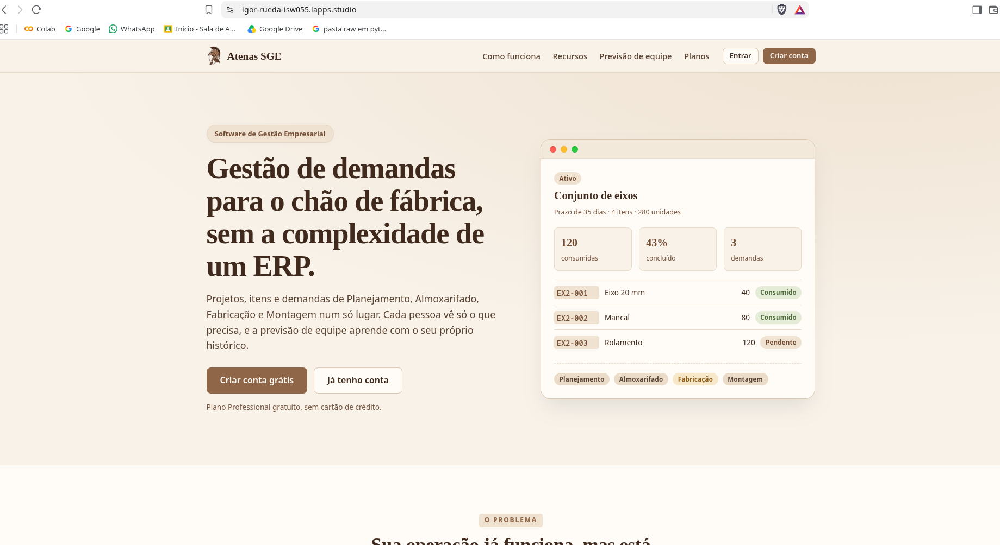

*Figura 1 — Landing page pública do Atenas SGE.*

#### 14.2 Listagem do recurso principal

**Projetos**, **demandas** e **análises**, vistos por um usuário logado. **Análises** é um recurso premium: só usuários com o plano Expert podem acessá-lo. Nestas imagens, o usuário logado é Expert.

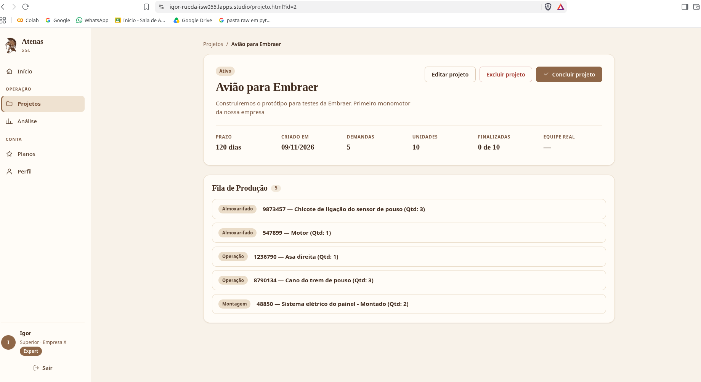

*Figura 2 — Listagem de projetos com usuário Expert logado.*

, exclusiva do plano Expert")

*Figura 3 — Análise de previsão de equipe (regressão linear), exclusiva do plano Expert.*

#### 14.3 O 403 de um papel sem permissão

Um **Planejador** tenta criar um projeto, ação permitida só ao **Superior**. A tela esconde o botão, mas a API recusa mesmo na chamada direta.

Rodado no console do navegador (`F12` → Console), logado como Planejador:

```js
fetch('/api/projetos', {
  method: 'POST',
  headers: { 'Content-Type': 'application/json' },
  body: JSON.stringify({ nome: 'teste' })
}).then(r => r.json().then(d => console.log(r.status, d)))
```

Resultado esperado: `403` com a mensagem "Só o Superior pode cadastrar projetos.".

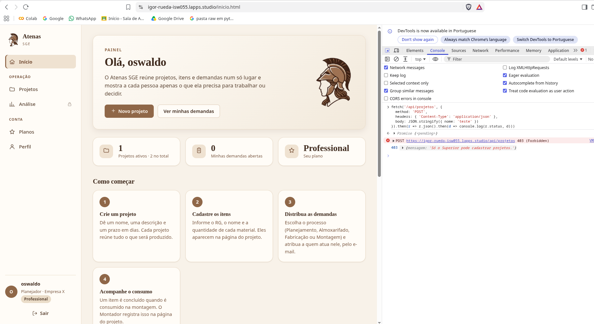

*Figura 4 — Resposta 403 ao Planejador que tenta criar um projeto.*

#### 14.4 Bloqueio ao abrir o registro de outro usuário

Isolamento entre empresas: um usuário da empresa B tenta abrir um projeto da empresa A.

1. Descubra o ID de um projeto da outra empresa: `SELECT id, nome, organizacao_id FROM projetos;`
2. Logado como usuário da empresa B, rode no console (troque `ID` pelo número):

```js
fetch('/api/projetos/ID').then(r => r.json().then(d => console.log(r.status, d)))
```

Resultado esperado: `404`. A API responde 404 (e não 403) de propósito, para não revelar que o registro existe em outra empresa.

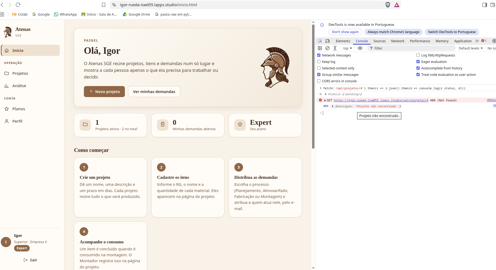

*Figura 5 — Resposta 404 ao tentar abrir um projeto de outra empresa.*

#### 14.5 Eventos de negócio no log

Consulta feita pelo `admin`, que é o único com acesso: `/api/logs?limit=50`.
Mostra quem fez, quando e a empresa (`org=...`) de cada evento, como `projeto_criado`, `demanda_criada`, `demanda_avancada` e `acesso_negado`.

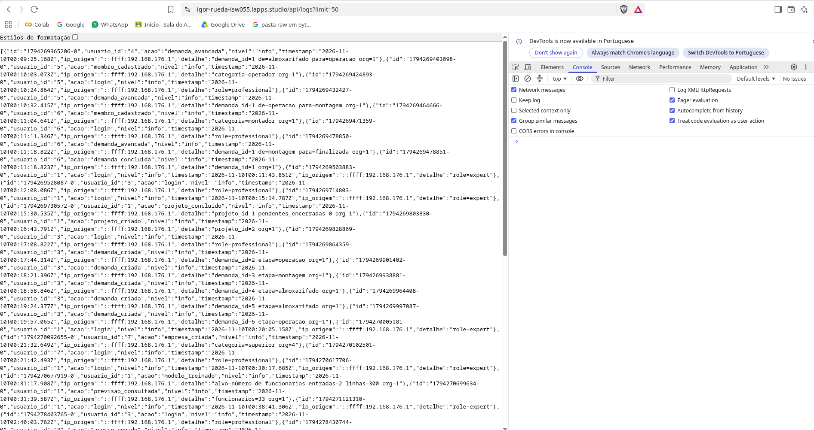

*Figura 6 — Eventos de negócio no log de auditoria, consultado pelo admin.*

#### 14.6 Arquivo no storage S3 (Garage, compatível com MinIO)

Foto de perfil enviada pela página **Perfil**, guardada no storage S3 do projeto (Garage, que usa o mesmo protocolo do MinIO).

Listagem do bucket (Portainer → container do Garage → Console):

```bash
/garage bucket list
/garage bucket info NOME_DO_BUCKET
```

 com a foto de perfil armazenada")

*Figura 7 — Bucket do Garage (S3) com a foto de perfil armazenada.*

#### 14.7 Stack no Portainer com os containers saudáveis

Stack publicada, com todos os serviços (`app`, `auth-service`, `pagamentos`, `log-service`, `profile-service`, `regressao` e o Garage) em execução e saudáveis.

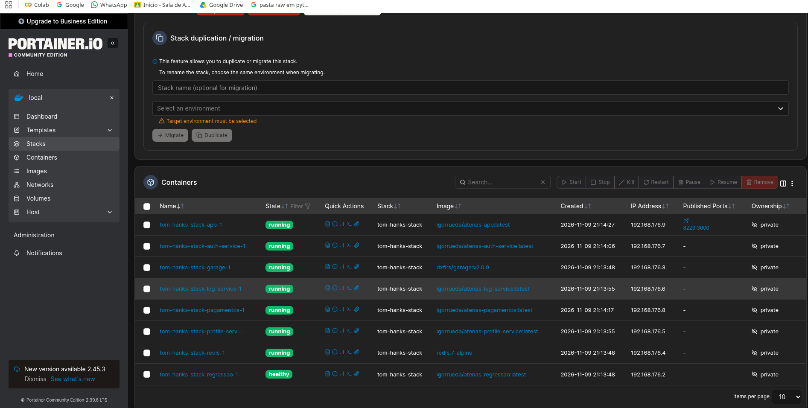

*Figura 8 — Stack no Portainer com todos os containers saudáveis.*

---

### Parte B — Assinatura com o Stripe (modo de teste)

Tudo no **modo de teste** do Stripe (aparece a faixa "Test mode" no painel). Cartão de teste: `4242 4242 4242 4242`, qualquer data futura e qualquer CVC. Nenhum print mostra chaves (`sk_...`, `whsec_...`).
Use uma **conta nova**, que nasce no plano Professional (Free).

#### 14.8 Assinatura concluída com o cartão 4242

Na página **Planos**, clique em *Assinar Expert*, preencha o checkout hospedado do Stripe com o cartão 4242 e volte ao app. O plano só muda quando o webhook chega: se ainda aparecer Professional, aguarde alguns segundos e recarregue (ou saia e entre de novo).

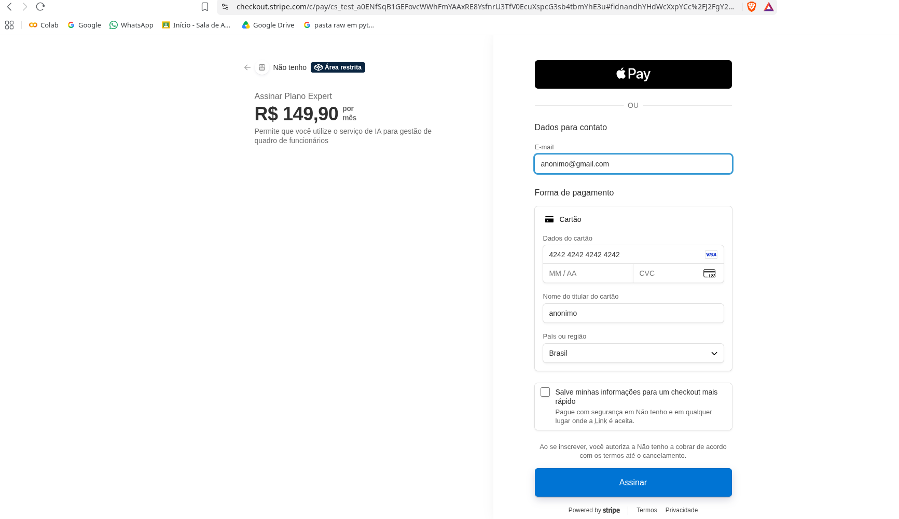

*Figura 9 — Checkout do Stripe pago com o cartão de teste 4242.*

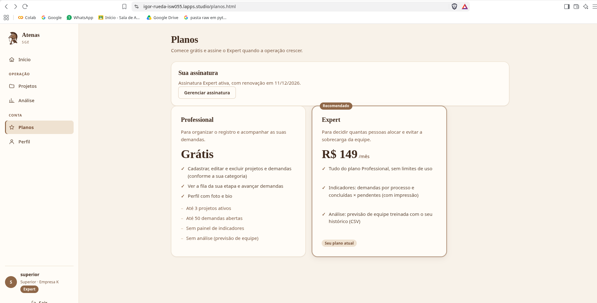

*Figura 10 — Plano Expert ativo no app depois do pagamento.*

#### 14.9 Dashboard do Stripe (modo de teste) com a assinatura

No painel do Stripe, com o modo de teste ligado: **Customers** (ou **Subscriptions**) mostrando a assinatura ativa de R$ 149,00/mês.

")

*Figura 11 — Assinatura ativa no dashboard do Stripe (modo de teste).*

#### 14.10 Webhook recebido

Mostra que o evento chegou e foi processado: no painel do Stripe, **Developers → Webhooks →** o endpoint, com as entregas respondendo `200`. Como reforço, o evento `assinatura_ativada` no log (`/api/logs?acao=assinatura_ativada`, como admin) ou a lista de webhooks do painel admin.

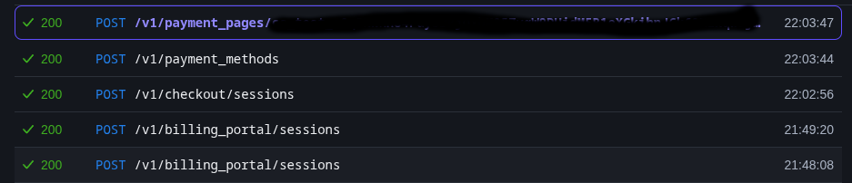

*Figura 12 — Webhook entregue no painel do Stripe.*

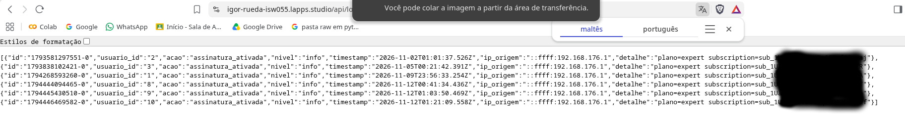

*Figura 13 — Evento `assinatura_ativada` no log de auditoria.*

#### 14.11 Limite bloqueando no Free

Com uma conta **Professional** (Superior), crie 3 projetos ativos e tente criar o 4º: a API recusa com `403` e a tela abre o convite para assinar o Expert, informando o limite (3).

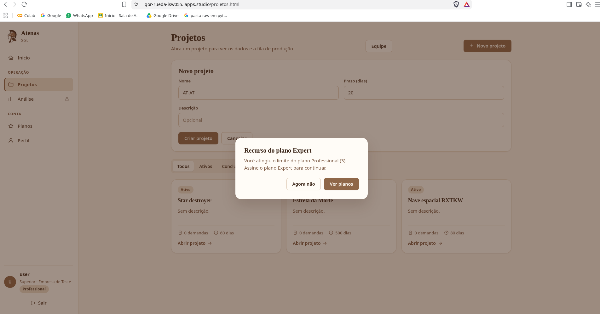

*Figura 14 — Limite de 3 projetos ativos do plano Free bloqueando o cadastro.*

#### 14.12 Painel admin

Logado como `admin`, menu **Painel admin**: assinaturas ativas, MRR de teste, usuários por plano, últimos webhooks e eventos do log.


*Figura 15 — Painel admin do app.*

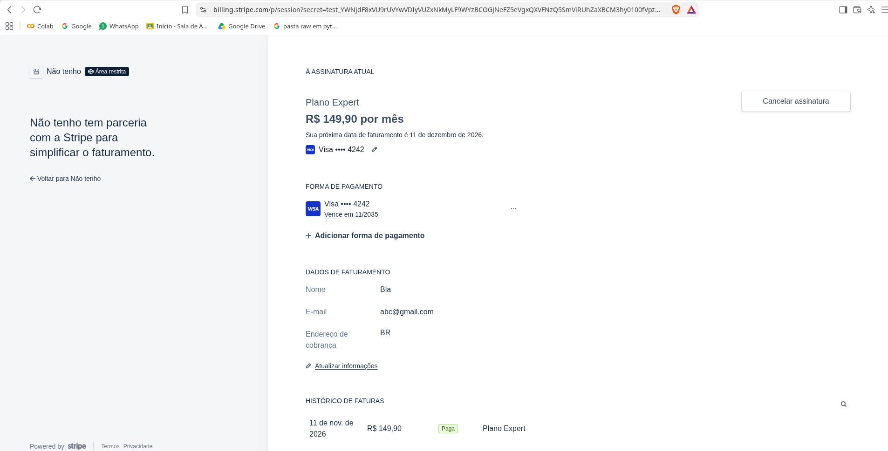

*Figura 16 — Cancelamento da assinatura no painel do Stripe.*